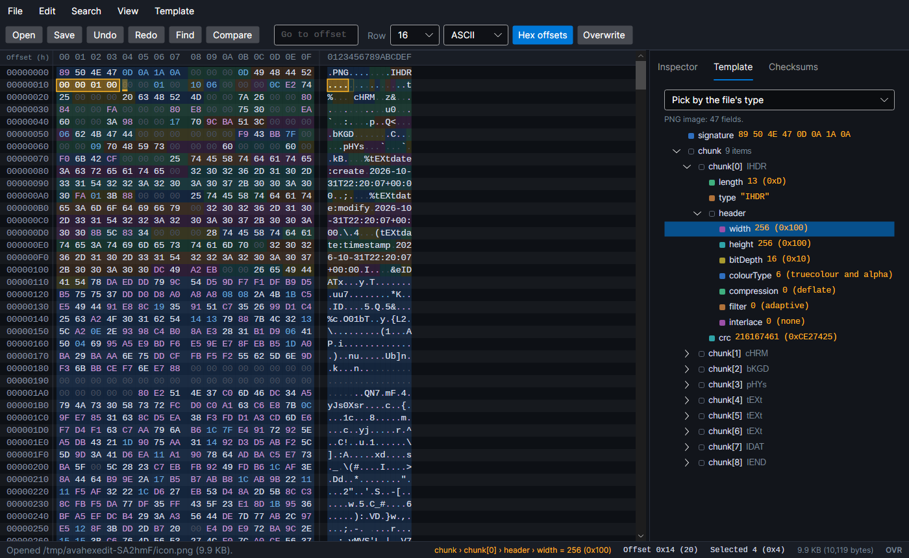
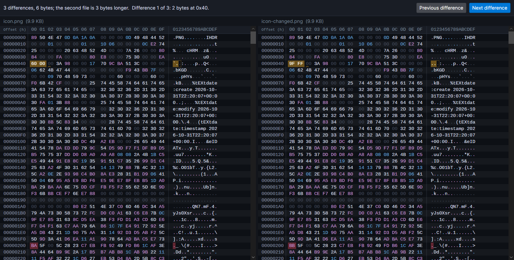

# AVAHexEdit

A hex editor for Windows, macOS and Linux, built with .NET 10 and Avalonia. Open a file of any size at once, edit it
byte by byte, and see what the bytes mean: the value at the caret read every common way, and structure templates that
name and colour each field of a PNG, a WAV, a ZIP, an executable or a LightWave object.



## What it does

- **Files of any size.** A file is read a page at a time as it is looked at, and edits are kept apart from it until
  saved, so a multi-gigabyte file opens straight away and inserting a byte at the start costs the same as at the end.
  Saving writes a new copy beside the file first, so a failure part way leaves the old file as it was.
- **Editing.** Type hex digits, or text in the text column (Tab moves between them). Write over the bytes or insert
  them (Insert switches), delete, cut, copy and paste (as hex, text, a C array or Base64), with undo and redo all the
  way back. Bytes changed since the file was opened or last saved are shown in orange.
- **The inspector** reads the bytes at the caret as every size of whole number (signed and unsigned, 8 to 64 bits),
  half, single and double floats, LEB128, ASCII, UTF-8 and UTF-16 characters, Unix time, FILETIME, MS-DOS date-time and
  a GUID, in either byte order. Type a new number into one and press Enter to write it.
- **Structure templates** name and colour every field of a file, with the file shown as a tree beside it: pick a field
  to select its bytes, and the status bar names the field under the caret. Built in: PNG, BMP, GIF, WAV, ZIP (and the
  formats built on it: .docx, .xlsx, .jar, .apk, .nupkg), ELF and Windows (PE) executables, and LightWave LWOB and LWO2
  objects. Write your own in a few lines: see [Writing templates](docs/templates.md).
- **Find and replace** hex bytes (with `??` for any byte), text in UTF-8 or UTF-16 (with or without matching case),
  or a number (16, 32 or 64-bit, float or double, in either byte order), forwards or back. Count every match, and
  replace one at a time or all at once (one step to undo).
- **Go to** an offset in hex or decimal, or move by one (`+100`, `-0x40`).
- **Checksums** of the whole file or the selection: CRC-32, Adler-32, MD5, SHA-1, SHA-256 and SHA-512.
- **Compare** two files side by side, scrolling together, with each difference marked and a button to step to the next.
- 8 to 64 bytes a row, offsets in hex or decimal, ASCII or Latin-1 in the text column, and a list of recent files.



## Keys

| | |
| --- | --- |
| `0`–`9` `A`–`F` | Type a byte, a digit at a time (in the text column, type text) |
| `Tab` | Move between the hex and text columns |
| `Insert` | Insert or write over |
| `Delete` / `Backspace` | Delete the byte after / before the caret, or the selection |
| `Shift` + arrows | Select |
| `Ctrl` `Home` / `End` | The start / end of the file |
| `Ctrl` `Z` / `Y` | Undo / redo |
| `Ctrl` `C` / `X` / `V` | Copy / cut / paste (hex in the hex column, text in the text column) |
| `Ctrl` `A` | Select everything |
| `Ctrl` `F` / `H` | Find / replace |
| `F3` / `Shift` `F3` | Find the next / previous |
| `Ctrl` `G` | Go to an offset |
| `Ctrl` `O` / `S` / `Shift` `S` / `N` | Open / save / save as / new |
| `F9` | Show or hide the side panel |

On macOS, `Cmd` works in place of `Ctrl`.

## Download

Builds for Windows (x64, x86, ARM64), macOS (Intel and Apple Silicon) and Linux (x64, ARM64 and 32-bit ARM, such as
a Raspberry Pi) are on the [releases page](../../releases): `latest` is the newest build of `main`. Unzip or untar
it and run `AVAHexEdit` (`AVAHexEdit.exe` on Windows). Each is a single self-contained file; nothing else needs
installing. `AVAHexEdit somefile.bin` opens a file from the command line.

## Building

```bash
dotnet build AVAHexEdit.slnx
dotnet test AVAHexEdit.slnx
dotnet run --project src/AVAHexEdit
```

.NET 10 (see `global.json`). `src/AVAHexEdit.Core` has everything but the window: the document (a piece table, with
undo), reading files a page at a time, search, the inspector, checksums, comparing, and the template language and its
built-in templates, so all of it is tested without a window. `src/AVAHexEdit` is the Avalonia app. The window tests
run on Avalonia's headless platform, and `AVAHEXEDIT_SHOTS=docs/images dotnet test` redraws the screenshots. CI
builds and tests every push and publishes all eight builds.

## License

MIT. See [LICENSE](LICENSE).
